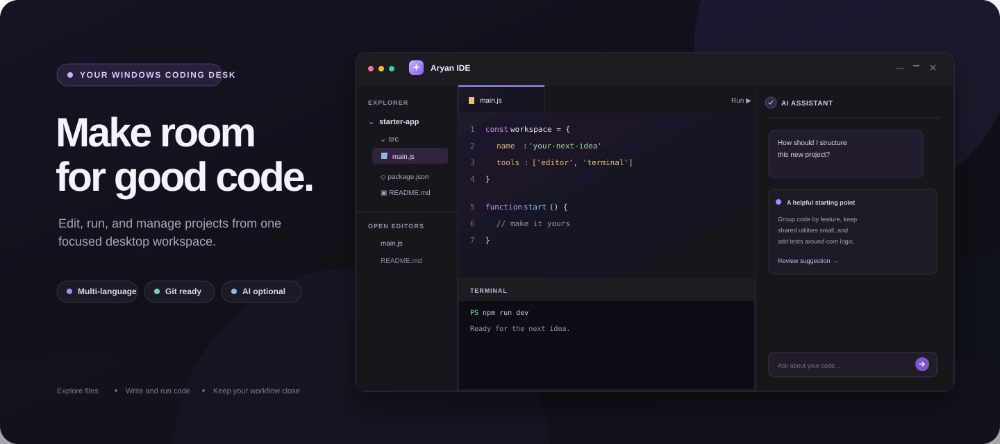

# Aryan IDE

  

  <strong>A Windows coding workspace for editing, running, and managing projects in one place.</strong>
   
  Electron · React · TypeScript · Monaco Editor · xterm.js

  <a href="#get-started">Get started</a> ·
  <a href="#what-you-can-do">Explore features</a> ·
  <a href="#how-a-session-flows">See the workflow</a> ·
  <a href="#extensions">Build extensions</a>

> The cover art is an original vector illustration of the workspace, not an in-app screenshot.

## At a glance

| Area | What it does |
| --- | --- |
| **Workspace** | Browse files, create or rename items, and search filenames or file contents. |
| **Editor** | Edit with Monaco, syntax highlighting, multi-file tabs, find and replace, folding, and a minimap. |
| **Run & output** | Run C, C++, Python, Java, and JavaScript files, then view output and send line-based input. |
| **Terminal** | Use PowerShell in an integrated terminal, with a standard-stream fallback if native PTY support is unavailable. |
| **Source control** | Review Git changes, commit, push, and pull through the installed Git CLI. |
| **AI assistant** | Connect an OpenAI-compatible streaming chat-completions endpoint and review code suggestions before inserting them. |
| **Extensions** | Add validated JSON commands, editor snippets, string settings, and accent themes. Extension JavaScript is not executed. |

## How a session flows

~~~mermaid
flowchart LR
    A["Open a project folder"] --> B["Browse or search"]
    B --> C["Edit and save"]
    C --> D{"Choose a tool"}
    D --> E["Run a supported source file"]
    D --> F["Use PowerShell"]
    D --> G["Review Git changes"]
    D --> H["Ask the AI assistant"]
    E --> I["Read output or send input"]
    G --> J["Commit, push, or pull"]
    H --> K["Review suggestion"]
    K --> C
~~~

## What you can do

### Write and find code

Open a folder from the title bar or Explorer. Monaco supports syntax highlighting, completion, folding, minimap, multi-tab editing, and find/replace. Choose a language mode next to **Run**; font size and word wrap are in Settings. Press <kbd>Ctrl</kbd> + <kbd>S</kbd> to save.

Workspace search includes:

- <kbd>Ctrl</kbd> + <kbd>P</kbd> — find a file by name
- <kbd>Ctrl</kbd> + <kbd>Shift</kbd> + <kbd>F</kbd> — search file contents
- <kbd>Ctrl</kbd> + <kbd>Shift</kbd> + <kbd>P</kbd> — open the Command Palette

Content search skips dependency and build folders and limits how many files and bytes it reads.

### Run programs

Press <kbd>F5</kbd> or select **Run & Debug**. The Run button supports these language-to-command mappings:

| Language | Commands |
| --- | --- |
| C | <code>gcc</code> |
| C++ | <code>g++</code> |
| Python | <code>python</code> |
| Java | <code>javac</code>, then <code>java</code> |
| JavaScript | <code>node</code> |

Set a command name or full executable path in Settings. While a program runs, the Output panel accepts line-based input. A process is stopped after 15 minutes.

### Use the terminal

Open **Terminal** or press <kbd>Ctrl</kbd> + <kbd>&#96;</kbd>. With a working native <code>node-pty</code> module, the panel hosts PowerShell with interactive input and terminal resizing. Without it, Aryan IDE uses a standard-stream fallback that supports basic line input.

### Work with Git

Source Control uses the Git CLI installed on the computer. Push and pull use the credential helper configured for Git, such as Git Credential Manager. Aryan IDE does not ask for a GitHub password.

### Connect an AI provider

In Settings, configure an OpenAI-compatible streaming chat-completions endpoint, model, and API key. Electron <code>safeStorage</code> encrypts the key; the main process decrypts it when needed. Suggested code opens in a review dialog before insertion. The rest of the IDE works without an AI key.

## Extensions

Extensions are folders with a <code>manifest.json</code> in the bundled <code>extensions/</code> directory or <code>%APPDATA%/aryan-ide/extensions/</code>. Version 1 accepts declarative commands, editor actions, themes, and string settings.

~~~mermaid
flowchart LR
    A["Extension manifest"] --> B["Validate JSON and limits"]
    B --> C["Show contributions in the IDE"]
    C --> D["User invokes a command or editor action"]
    D --> E["Review snippet before insertion"]
    C --> F["Select a validated accent theme"]
    B -. "No JavaScript entry point is run" .-> G["No extension code execution"]
~~~

The bundled [sample extension](extensions/example-extension/README.md) demonstrates a greeting command, a TODO editor action, a theme, and a saved snippet setting. See [EXTENSIONS.md](EXTENSIONS.md) for the manifest format and limits.

## How the app is put together

~~~mermaid
flowchart LR
    UI["React renderer Monaco · xterm.js"] -->|"typed, narrow API"| Bridge["Preload bridge"]
    Bridge --> Main["Electron main process"]
    Main --> Files["Workspace files"]
    Main --> Runner["Language processes"]
    Main --> Git["Git CLI"]
    Main --> Terminal["PowerShell / node-pty"]
    Main --> KeyStore["Electron safeStorage"]
    Main --> Provider["Configured AI endpoint"]
~~~

The renderer has no direct Node.js integration. Filesystem, process, Git, terminal, and credential operations are handled in the main process through the typed preload API.

## Get started

### Requirements

- Windows 11 (Windows 10 22H2 should also work)
- Node.js 22 or newer and npm
- Git for Windows for Source Control
- Optional language tools: GCC/G++, Python, JDK (<code>javac</code> and <code>java</code>), and Node.js
- Visual Studio Build Tools with the **Desktop development with C++** workload for native PTY rebuilds

### Run from source

~~~powershell
npm install
npm run dev
~~~

If you installed Visual Studio Build Tools and want native PTY support, rebuild <code>node-pty</code> first:

~~~powershell
npx electron-rebuild -f -w node-pty
npm run dev
~~~

Create a Windows installer with <code>npm run dist</code>; it is written to <code>release/</code>. Use <code>npm run build</code> to compile the main, preload, and renderer bundles without creating an installer.

## Safety and current limits

**Programs run as your Windows user.** The runner does not sandbox user programs. Treat unfamiliar code as untrusted; use a disposable Windows account or virtual machine when needed. Programs run from the workspace directory. For full terminal or TTY interaction, use the integrated PowerShell terminal.

Other current limits:

- The Problems panel shows Monaco markers for languages with built-in services; it is not a compiler or language-server integration.
- The Debug Console indicates that a debugger adapter is needed; Aryan IDE does not simulate breakpoints.
- The standard-stream terminal fallback does not provide full terminal control.
- Extensions are parsed as JSON only. Extension JavaScript entry points are never executed.

## Project map

~~~text
src/main/       Electron main process: workspace, runner, terminal, Git, AI, settings
src/preload/    narrow, typed context bridge
src/renderer/   React interface, Monaco editor, xterm.js, styles
src/shared/     shared IPC types
extensions/     sample extension manifest and guide
tests/          workspace path and runner plan tests
scripts/        build utilities
~~~

## Troubleshooting

| Issue | Try this |
| --- | --- |
| <code>node-pty</code> fails to install | Install Visual Studio Build Tools with **Desktop development with C++** and Python, then run <code>npx electron-rebuild -f -w node-pty</code>. |
| A compiler is missing | Set its PATH command or full executable path in Settings, then check it in a new PowerShell terminal. |
| PowerShell does not start | Confirm Windows PowerShell is available at <code>%SystemRoot%\System32\WindowsPowerShell\v1.0\powershell.exe</code>. |
| Source Control is empty | Open a repository folder and check <code>git --version</code> in PowerShell. |
| AI calls fail | Check the endpoint supports OpenAI-compatible streaming <code>/chat/completions</code> requests and confirm the model name and API key. |
| Windows warns about the installer | Local installers are unsigned. Distribution requires a code-signing certificate. |

## Checks

Run the current workspace-containment and runner-plan tests, TypeScript check, and production build with:

~~~powershell
npm test
npx tsc --noEmit
npm run build
~~~

The runner tests cover workspace path containment and argument plans, including a JavaScript run through the current Node executable. C/C++/Python/Java runtimes, native PTY rebuilds, external AI providers, Git workflows, and installer installation need verification on a machine with those tools and credentials available.

---

Built for focused Windows development · <a href="EXTENSIONS.md">Extension guide</a> · <a href="extensions/example-extension/README.md">Sample extension</a>

