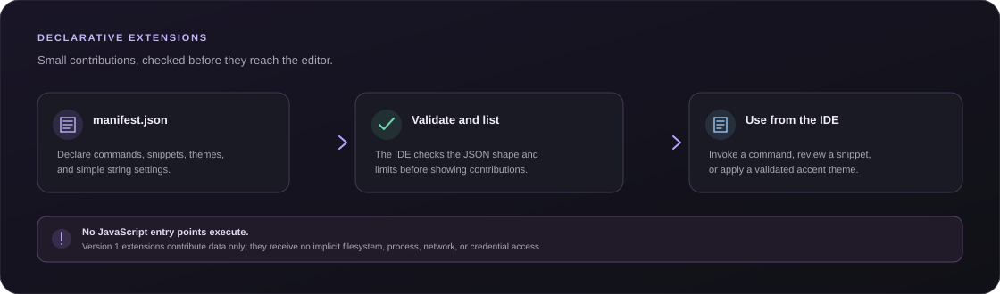

# Aryan Sample Tools

  

<strong>A tiny, data-only extension that adds useful editor actions and a theme.</strong>

## What it adds

| Contribution | In this sample |
| --- | --- |
| Command | **Insert a greeting** adds a comment snippet to the active editor. |
| Editor action | **Insert TODO comment** inserts a TODO snippet. |
| String setting | <code>signature</code> fills the <code>{{signature}}</code> placeholder in snippets. |
| Accent theme | **Violet Dawn** applies a dark theme with a violet accent. |

## Try it in Aryan IDE

1. Open the **Extensions** panel and find **Aryan Sample Tools**.
2. Open the Command Palette with <kbd>Ctrl</kbd> + <kbd>Shift</kbd> + <kbd>P</kbd>, then choose **Insert a greeting**. The editor shows a review dialog before the snippet is inserted.
3. Try **Insert TODO comment** from the Extensions panel or Command Palette.
4. Edit the <code>signature</code> setting in the Extensions panel and invoke a snippet again to see the placeholder expand.
5. Apply **Violet Dawn** from the extension card to change the accent color.

## How a contribution reaches the editor

~~~mermaid
flowchart LR
    A["manifest.json"] --> B["IDE validates the declaration"]
    B --> C["Command Palette / Extensions panel"]
    C --> D["User chooses an action"]
    D --> E["Review snippet"]
    E --> F["Insert into active editor"]
    C --> G["Apply validated theme"]
~~~

## Manifest preview

The complete manifest is in [manifest.json](manifest.json). It declares the sample's string setting and contributions:

~~~json
{
  "name": "Aryan Sample Tools",
  "settings": [
    { "id": "signature", "label": "Comment signature", "type": "string", "default": "Aryan IDE" }
  ],
  "contributions": {
    "commands": [
      { "id": "insert-greeting", "title": "Insert a greeting", "snippet": "// Hello from the Aryan sample extension\n// {{signature}}\n" }
    ],
    "editorActions": [
      { "id": "insert-todo", "title": "Insert TODO comment", "snippet": "// TODO: describe the next step\n// {{signature}}\n" }
    ],
    "themes": [
      { "id": "violet-dawn", "name": "Violet Dawn", "base": "dark", "accent": "#a78bfa" }
    ]
  }
}
~~~

## Safety model

Aryan IDE parses the manifest as JSON and exposes only declared contributions. It does not load or execute an extension's JavaScript entry point, and version 1 extensions receive no implicit filesystem, process, network, or credential access. Snippet insertion is user-invoked and reviewable.

See the root [extension format and limits](../../EXTENSIONS.md) and [project guide](../../README.md).
